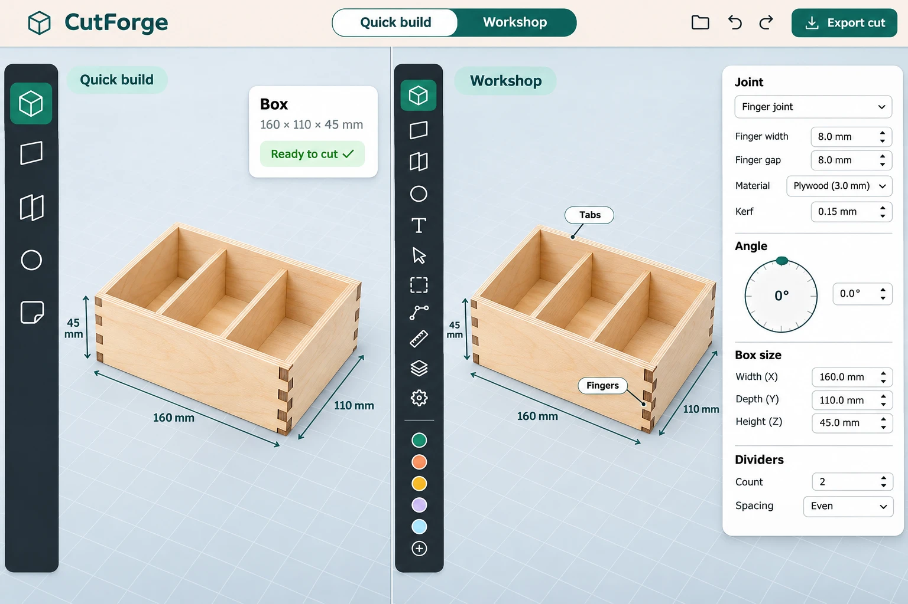
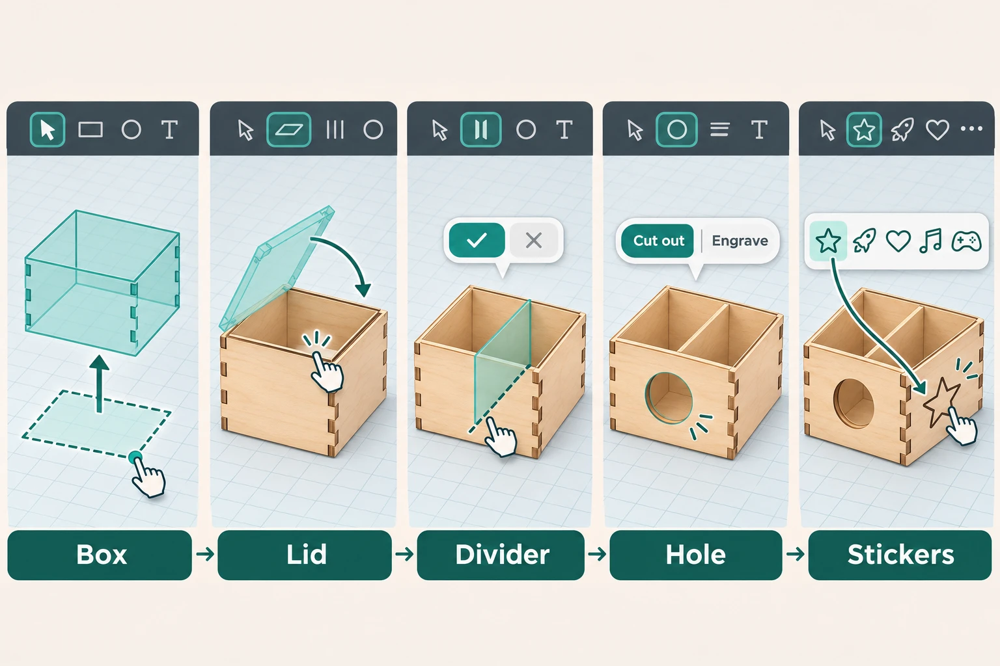
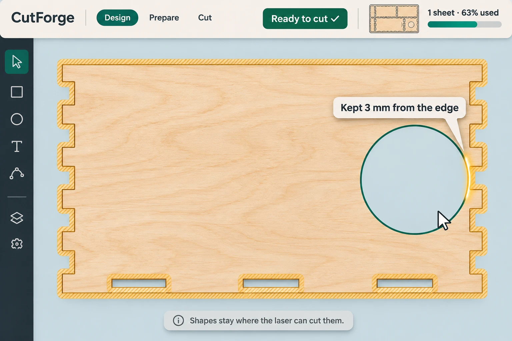

# CutForge: Quick build, an easy mode on the same engine: brief

Planning notes from 2026-11-09, made after milestones 25–27 and the plan for milestones 28–36 (`PANELS_AND_DIVIDERS.md`). This brief starts at 37. It depends on milestone 30 (one floating ✓) and on milestone 35's engine (nets that lie flat); see *Order and size*.

## 1. What changes for a student

- **Two modes, one design.** *Quick build* and *Workshop* (today's editor) are two views of the same design. A segmented toggle in the top bar switches between them at any time. Nothing about the design changes when you switch.
- **Five actions instead of seven tools.** In Quick build the tool rail has **Box**, **Wall / lid**, **Divider**, **Hole**, and **Text & stickers**. Each one makes a ghost first, and **✓** (or Enter) makes it, as one undo step.
- **The app decides the engineering.** Joint kinds, angles, kerf, clearance, folds and snapping are chosen for you. A *How it's built* toggle shows the joints the app picked.
- **You can't make a file the laser can't cut.** Shapes stay where the laser can cut them while you drag them. Instead of the export check list there is a **Ready to cut ✓** badge, and when something still goes wrong, one button fixes it.
- **Missions.** Optional goals with a starter design and a checklist (*Holds 12 pencils*, *3 compartments*, *Fits on one sheet*, *Your name engraved*). The teacher can choose missions for a class.
- **What goes inside.** Drop ghost objects (pencils, dice, a deck of cards, a phone, or your own size) into compartments. A compartment turns green when its object fits, and amber with how much more room it needs when it doesn't.
- **Sheet meter.** *1 sheet · 63% used*, always visible.
- **Not a dead end.** Each Quick build card has **More…**, which opens the Workshop control for that one thing. Parts made with Workshop tools show in Quick build read-only, with *Open in Workshop*.

## 2. Decisions

| Topic | Decision |
| --- | --- |
| What a mode is | **A viewer preference, not part of the design.** `ViewPrefs.mode: 'quick' \| 'workshop'`, per browser. A class can set the default. Files open the same in both modes. |
| Same engine | **No new design fields** besides an optional mission id (`Design.mission`, like `Design.template`). Every Quick build action is a recipe over existing `ops`. Golden exports stay byte-identical. |
| Expression vs engineering | **Expression stays open:** box shape and size, compartments, wall outlines (gables, slanted tops), holes, engraving, text, icons. **Engineering is automatic:** joint kinds, joint counts, angles other than 90°, kerf, clearance, sheet, folds and fold-overs, through-cuts, snapping, per-board materials, construction panels. |
| Joints | **The design's defaults** (`designKind`, the `pref` fallback, `newTrayKinds`). Joint cards and the *Joints* section are hidden. *How it's built* turns on `viewPrefs.joints`. |
| Angles | **90° only** in Quick build. Leaning parts come from templates (the card stand). |
| Material | **One material**, chosen on the start screen or set by the class profile. Kerf and clearance are read-only. |
| Guardrails | **Prevent, don't report.** During drags, shapes are kept inside their panel by at least `minWeb`, away from joint slots and tabs, and apart from other cut-outs. Text has a minimum size. What can't be prevented gets a one-click fix. |
| Missions | **A registry, like templates.** A mission is a template with parameters, plus goals checked against the derived design. |
| Teacher | **Class default mode, optionally locked.** A new optional `mode` column on `classes`. |
| Name | **Not "Easy".** *Quick build* and *Workshop* (Hebrew names to choose with the teacher). |

**My calls (say if you want them different):**

- **Opening a Workshop design in Quick build** shows everything. Parts that use hidden features (an angled panel, a fold-over, a through-cut, a board in another material) can be selected but not edited, and their card says why, with *Open in Workshop*. Quick build never changes them.
- **More…** switches only that card to its Workshop version until the selection changes. It does not switch the mode.
- **The divider gesture** (draw a line across the box) is shared with Workshop. See the note on milestone 32 below.
- **Stickers** are a small bundled set of line icons with a clear license, recorded in `THIRD_PARTY.md`. Nothing is fetched at run time.
- **Missions are never required.** A blank Quick build design has no checklist, only the *Ready to cut* badge and the sheet meter.
- **The four first-use hints** (`src/ui/Hints.tsx`) stay in Workshop. In Quick build they are replaced by the first mission or by one line of guidance under the rail.

## 3. Note on milestones 28–36

- **Milestone 30** (a ghost and ✓ for everything, the tool returns to *Select*) is the foundation of Quick build. Every Quick build action uses its `ConfirmBar` and preview transactions.
- **Milestone 35's engine** (automatic flat-net fixes) is needed before Quick build offers card and corrugated boxes that aren't convex. Quick build never shows *Keep in one piece*.
- **Milestone 32 conflicts with Quick build.** It removes the automatic divider sets (*2 across, 1 along*), the easiest divider path for a beginner, and replaces them with clicking a wall and Shift-clicking the opposite one, which beginners rarely find. **Before building 32,** add the shared gesture from milestone 38 (draw a line across the box), or build 38's divider part together with 32. The organiser template keeps `addDivider`, so its counts still work.
- **Milestones 31, 33, 35's edge picking, 36, and construction panels (28)** are Workshop only. Quick build only has to display designs that use them, read-only.

## 4. Milestones

### Milestone 37: the mode and the feature table

- `ViewPrefs.mode: 'quick' | 'workshop'` in `src/store/store.ts`, saved with the other view preferences. Default `'workshop'` for existing browsers (anyone with saved prefs), `'quick'` for new ones and for classes that set it.
- `src/easy/features.ts`: one table, `Feature → { quick: 'show' | 'auto' | 'hide' }`, and a `useFeature(f)` hook. Components check it instead of `mode` directly, so the table is the only place the split is decided:

  | Feature | Quick build |
  | --- | --- |
  | Tool rail: Panel, Rectangle, Rounded rectangle, Circle, Polygon, Text, Import | replaced by the five actions (milestone 38) |
  | Operation dots, through-cut `#` switch | hide (the shape card has *Cut out / Engrave*) |
  | Score and Add operations | hide |
  | Joint cards in `Connections.tsx`, *Joints (advanced)*, finger counts, seam pills | hide |
  | Settings card *Joints* and *Snapping* sections (`DesignSettings.tsx`) | hide |
  | Settings card *Material and fit* | show read-only |
  | Material drawer (`MaterialDrawer.tsx`) | read-only |
  | Grow card angle dial, Up/Down flip, side walls, span, adapt toggle, ghost outline edit (`EdgeBar.tsx`, `AngleDial.tsx`) | hide (90°, whole edge, adapt on) |
  | Wall and base *Edit outline* (corners, points) | show |
  | Curved points | hide |
  | Fold-over section, tray *Own height*, *Wall it* | hide (*Wall it* stays) |
  | Gizmo | show (move and turn floor panels and shapes) |
  | Arrays, align and distribute | show |
  | Copies to cut | show |
  | Fold slider | show |
  | Cut plan view | show (dragging pieces on the sheet stays) |
  | Export check list | replaced by the badge (milestone 39) |
  | View settings | show |

- **Top bar:** a *Quick build | Workshop* toggle next to the view switch. When the class locks the mode, the toggle is hidden.
- **Read-only parts:** `isWorkshopOnly(d, panelId)` (angled hinge, fold-over, through-cut on it, another material, construction). Their cards show *Made in Workshop* and *Open in Workshop*.
- **More…** at the bottom of the Quick build cards for a panel, a shape and a tray: it renders the Workshop version of that card.
- **Class default:** an optional `mode` column on `classes` (`'quick' | 'workshop' | null`, plus a `modeLocked` flag), a Drizzle migration, the teacher's class settings, and `GET /api/classes/:code` returning it. A student who enters a class code gets the class's default.
- **i18n:** every new string in `en.ts` and `he.ts`.
- **Tests:**
  - unit: the feature table covers every feature the components ask for (no feature used that isn't listed).
  - unit: switching the mode never changes the design (deep-equal before and after).
  - e2e: Quick build shows five tools and no joint cards; Workshop shows today's editor; a Workshop design with an angled panel opens in Quick build with that panel read-only.
  - e2e: a class with a locked Quick build default hides the toggle.

### Milestone 38: the five actions

Each action is a recipe in `src/easy/recipes.ts`, built only from existing `ops`, run as one preview transaction and confirmed with milestone 30's ✓ (one undo step). After ✓ the rail returns to *Select*.

- **Box.** The card asks for the footprint: *Rectangle* or *Regular* (3–12 sides; *Freeform* from the polygon tool's click mode when shown with More…). Drag on the floor; the ghost tray rises at the last height used (45 mm the first time); drag the push-pull arrow or type the height; ✓. Uses `addRootPanel` / `addPolygonPanel` + `addTray` with the design's tray kinds. With milestone 35, the height arrow shows the flat-net tick and the automatic fix applies.
- **Wall / lid.** Hover shows free edges. Click one: the ghost grows at 90° on the whole edge, with *Adapt to neighbours* on, so a lid snaps onto the opposite wall and a wall matches its neighbour. ✓. Uses `growPanel` with the design's default joint.
- **Divider.** Draw a line inside a box (on its base). Its ends snap to the inner faces of the walls.
  - When the line runs from wall to wall across facing, parallel walls, it becomes a real divider: `planDividerBetween` with the two picked faces, at the line's position, height `lower wall − DIVIDER_GAP`, crossing other dividers with half-laps.
  - Otherwise it is a standing placed panel (milestone 29) on the base.
  - The compartment sizes show while drawing and after; dragging a divider snaps to equal compartments, as now.
  - This gesture is also added to Workshop (the Divider entry under the Panel tool), so milestone 32 doesn't leave Workshop without an easy path.
- **Hole.** Choose circle, rectangle or rounded rectangle in the card, drag on a panel; the shape card offers *Cut out | Engrave*. Uses `addDetail` with `op: 'cut'` or `'engrave'`.
- **Text & stickers.** Text as today (`addText`), engraved by default. Stickers: a tray of bundled icons (`src/easy/stickers/`, line icons stored as polylines like an imported SVG); drop one on a panel to place it with `addPathShape`, engraved by default, *Cut out* available.
- **Tests:**
  - unit: each recipe on a fresh design gives the same panels and connections as doing the steps in Workshop (deep-equal after `solve`).
  - unit: a wall-to-wall divider line equals `addDividerBetween` at that position; a line that stops short makes a placed standing panel.
  - e2e: Box → Lid → two Dividers → Hole → Text → Sticker, each with ✓, then six undos return to the empty design.
  - EN/HE screenshots of each action's ghost.

### Milestone 39: guardrails and Ready to cut

- **Keep-out zones** (`src/easy/guard.ts`), built from the geometry `validate` already uses (`minWeb`, `panelNotches`, `panelExtras`, `detailBBox`, `shapeContours`):
  - the panel outline inset by `minWeb`
  - around every slot, finger, tab and flap on the panel, by `minWeb`
  - around other cut-outs on the panel, by `minWeb`
- **During drags** in Quick build (moving, resizing, drawing, the gizmo, typed values), shapes are clamped to the allowed area: the nearest allowed position along the drag. The zones show as a faint amber hatch while dragging. When a clamp happens, a small tooltip says why (*Kept 3 mm from the edge*).
- **Text:** a minimum size per material, so engraved letters stay readable and cut-out letters keep their bridges (`val.stencil` offers *Engrave instead*).
- **One-click fixes** for what can't be prevented (a panel resized under its shapes, a material change). `fixIssue(d, issue)` per issue kind: move the shape inside (`val.holeOutside`, `val.tooThin`, `val.slotEdge`), move overlapping cut-outs apart or merge them (`val.shapesOverlap`), switch a stencil to engrave (`val.stencil`), shrink the panel to the sheet (`val.tooBig`), repack (`val.offSheet`, `val.piecesOverlap`). Workshop gets the same buttons in the export check.
- **Ready to cut badge** in the top bar: green *Ready to cut ✓* when `validate` reports nothing that blocks cutting, otherwise *1 thing to fix*, which opens the fix. Warnings that don't block cutting (`val.split`, `val.bevel`) are shown as notes, not blockers.
- **Sheet meter** next to the badge, from `pack`: *1 sheet · 63% used*, with a thumbnail of the sheet.
- **Tests:**
  - **unit (fuzz):** extend `tests/autoseam.test.ts` with 500 seeded random sequences of Quick build actions and drags; after each, `validate` reports no blocking issue.
  - unit: each `fixIssue` clears its issue and changes nothing else.
  - e2e: drag a circle toward a wall's edge; it stops at the zone and the tooltip shows; the badge stays green.
  - e2e: resize a panel under a shape in Workshop, switch to Quick build, the badge says *1 thing to fix*, the fix clears it.

### Milestone 40: missions, what goes inside, and the payoff

- **Missions** (`src/easy/missions.ts`), a registry like `src/templates/registry.ts`: `{ id, version, title, description, template, params, goals: Goal[] }`. A goal is a check over the derived design with a label and the panel it points to:
  - inside sizes and compartment counts (`clearBox`, the divider rows)
  - an object fits (the objects below)
  - pieces and sheets (`buildPieces`, `pack`)
  - has an engraving or text on a given panel
  - ready to cut (milestone 39)
- **Start screen:** in Quick build, step 2 offers missions next to the templates and *Blank*. A mission card shows its goals.
- **Mission card** in the stage: the checklist, updated live; clicking a goal selects what it is about. Stars for goals done (one per goal group, three at most). `Design.mission = { id, version }` so a submission shows the teacher which mission it was.
- **Teacher:** pick the missions shown to a class (an optional list on `classes`); the submissions table shows the mission and its goals met.
- **First missions:** *Pencil box* (holds 12 pencils, 3 compartments, one sheet, name engraved), *Dice tray* (a hexagon tray, 6 dice fit, a sticker), *Card stand* (from the card stand template; your deck fits, angle chosen), *Game organiser* (4 compartments, a lid, everything fits on one sheet).
- **What goes inside:** an object library (`src/easy/objects.ts`): pencil, marker, dice, deck of cards, phone, coin, or *Your own size* (W × D × H). Drag an object into a compartment; it shows as a translucent ghost resting inside. The compartment is green when the object fits (with the material's clearance) and amber when it doesn't, with how much more room it needs. Objects are view state stored with the design (`Design.contents?`, ignored by pieces, packing and export), so they survive a reload and a submission.
- **Assembly animation:** a *Show how it goes together* button plays the fold slider and then moves each separate piece from its flat position to its place, one at a time (view only, reuses `foldT` and the pieces' frames).
- **Tests:**
  - unit: each mission's starter meets none or some of its goals and the reference solution meets all of them.
  - unit: an object fits a compartment exactly when its footprint plus clearance is inside `clearBox` for that compartment.
  - e2e: start *Pencil box*, drag a divider until the pencils' compartment turns green, engrave a name, the checklist is complete and the badge is green.
  - EN/HE screenshots: a mission card, objects in compartments (green and amber), the sheet meter.

### Milestone 41: final verification

- `npm test`, the e2e app specs, the golden exports (byte-identical for designs that don't use missions or contents) and the fuzz test.
- A classroom-style run-through: a new browser, Quick build, one mission from start to *Ready to cut* in under 20 minutes, in English and Hebrew.
- EN/HE screenshots into `docs/quick-shots/`: Quick build and Workshop side by side, each action's ghost, a clamped drag with its tooltip, the badge and the sheet meter, a mission with objects.
- README *Using it* (a new Quick build section), PROGRESS entries and DECISIONS (a mode is a viewer preference, the feature table, guardrails prevent instead of report, missions as a registry).

### Order and size

Suggested order, after milestones 30 and 35's engine: **37, 38, 39, 40, 41.** Build 38's divider gesture together with milestone 32 (or before it), so Workshop never loses its easy divider path.

- 37 first: the feature table is what every later Quick build card checks.
- 38 needs 30's ghost bar and 29's standing panels (for dividers that stop short).
- 39 is independent of 38 apart from where the badge sits, and could go first if preventing broken files matters more than the new tools.
- 40 needs 39's badge for its *Ready to cut* goal.

37 is a few days (mostly hiding controls, plus the class column). 38 is about a week. 39 is about a week; the keep-out zones and the fuzz test are the largest part. 40 is one to two weeks; missions, objects and the animation can each ship on their own. 41 is two or three days.

## 5. Illustrations

Concept images made with GPT Image. They show the idea, not the exact interface: labels, controls and the top bar differ from what the milestones above describe (for example, there is no *Design / Prepare / Cut* switch and no finger width field).

**Same design, two modes**

**Five actions, one step each** (milestone 38)

**A broken file is impossible** (milestone 39)

